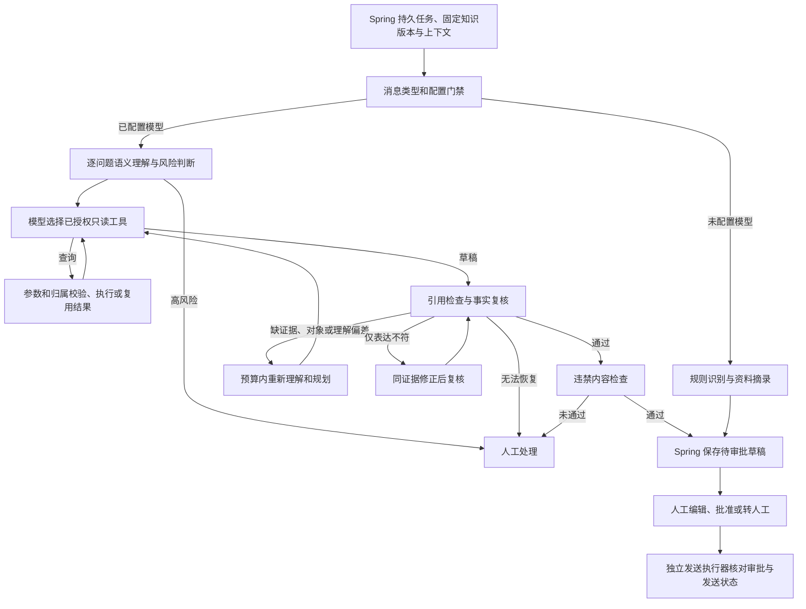

# Agent 编排与迁移说明

常见电商咨询的场景矩阵、应答原则、知识来源分工及后续覆盖清单见[客服常见咨询与应对策略](knowledge/客服常见咨询与应对策略.md)。该文档是设计说明，不会自动加载为运行时知识。

当前实现迁移了上游文本 Agent 的模型响应封装、工具 Schema、工具执行结果回传、多轮工具循环与循环上限。适配后的实现位于 `services/agent-service/copilot/agent/`，不依赖 PyQt、旧配置单例或旧业务数据库。来源信息见根目录 `NOTICE`。

## 执行流程

这里的“独立检查”是额外的模型调用，不能证明回复一定正确。事实质量仍需真实模型评测与人工核对；没有将提示词当成权限控制。

## 逐问题意图与订单边界

`agent/understanding.py` 在生成前执行一次结构化意图识别。当前问题与此前最多 6 条买家/客服消息用于理解指代，分别标记库存、商品、价格、发货、物流、售后规则、售后操作诉求，以及是否需要订单事实。批次内每个问题分别识别，不把历史六个问题合成一个新诉求。解析结构不合法时停止；初步语义有歧义时允许先进行已授权只读查询。对象仍不明确时不能猜测绑定，须澄清或交人工。

库存与每份包含数量由模型结合当前问题、前文和查询结果区分，不再以正则强制覆盖模型结果。理解是可修正的假设，不据此永久移除其他已授权只读工具。库存回答仍必须引用同一商品的本次平台库存查询，静态资料、订单购买数量和每件包含数量不能代替。SKU 明细完整且销售状态和库存均可确认时，工具计算匹配范围的可售件数合计；截断、未知库存或状态不明时不生成合计，不能把件数自行换算成包装内数量。表达要求由版本化回答规范和通用默认提示约束，不再追加订单状态或目录问法专属的系统提示片段。

明确按名称、国家、品牌或品类问有无时，意图识别输出 `product_scope=catalog` 和 `product_keywords`。检索词必须出现在当前问句中；空词、问法词和历史商品词不能用于全店搜索。本次生成不再沿用历史商品的定位与参数。例如“法国纸币有吗”先只读查询当前店铺完整在售列表，再按名称同时匹配“法国”“纸币”；有多款命中不构成问句歧义，也无需先选 SKU。

工具查询成功但零命中时，模型会看到 `matched_count` 和本次关键词，可按工具说明删去过窄的修饰词后再查；例如“波兰钱”可改查“波兰”，匹配商品名“波兰纸币”。查询词必须是当前买家原话的子串，不能凭空添加同义词或从历史借词。模型与工具循环默认最多 4 轮（`LLM_MAX_ROUNDS` 可配置为 1–8）；参数错误、无命中或可恢复的工具结果可据此调整，登录/权限/平台持续错误不做盲目重复请求。

目录查询由模型根据工具描述选择；代码不根据“最便宜”等词语强制触发工具。只问有无时，目录检索优先展示有库存款式，保留单品平台引用和本次检索摘要，不附带价格或每款库存。名称未命中只能表述为本次在售列表未检索到匹配商品；它不是语义分类覆盖证明，不能据此断言全店没有同类商品。库存未知、库存为零、接口失败分别处理；失败和未知均不能作为无货依据。明确询问某款库存时仍使用同商品校验，不使用目录查询绕过。

问某个名称或品类下哪款最低价时，模型调用 `get_shop_products` 并设置 `comparison=lowest_in_stock_price`。此模式读取匹配商品的完整 SKU，按普通拼单价（或买家明确问单买时按单买价）比较有货且上架规格；目录列表价不用于推断 SKU 最低价。候选超过 12 项、任何商品的 SKU 明细不完整或查询失败时，不给全范围最低价结论。并列最低会保留；活动、优惠券和运费不在比较范围内。问一个已确定商品的规格价格时使用 `get_product_skus`。

普通“退款多久到账”“退货运费谁承担”“售后入口在哪”允许检索已发布规则，只解释条件与操作入口。直接退款、赔偿、质量争议、投诉威胁、激烈辱骂及实际改地址诉求标为需人工处理。启用模型意图识别时，根据实际诉求区分规则咨询与操作请求、已发生纠纷；不因单个风险词直接拦截。明确配置的关键词仍是强制门禁；未启用语义识别时保留保守词法回退。部署变量 `AGENT_HANDOFF_TERMS` 可用逗号增加人工处理关键词，最多 50 个；当前没有管理页配置入口。没有售后频次等行为数据时，不判断“恶意买家”。

Java 的 `OrderContextResolver` 只从该买家同一会话、当前问题及之前的订单卡片或已观察格式的订单号提取查询线索。多个订单号存在歧义时不选择；晚于问题的卡片不回填进旧问题。Spring 使用当前店铺登录态只读查询，并核对平台返回的订单号及买家 UID 后才提供摘要。模型不能指定其他订单或买家，也不能修改订单。

订单查询先用 `/latitude/order/orderSimpleDetail` 核对订单号与买家 UID，再使用正常商家详情页实际调用的 `/mangkhut/mms/orderDetail` 读取状态。完整详情再次核对订单号，使用平台直接返回的 `order_status_str` 分类；不凭单个数字状态码推断。当前真实测试订单已核实为“已取消”，并取得下单时间。收件人、地址、电话和未使用的原始详情字段不进入 Agent 摘要。

订单详情查询需要正常商家订单页生成的请求头；Cookie 和必要请求头由 Spring Java Playwright 从正常订单页获取，验证只读查询成功后加密保存为 `order-session.enc`，绑定店铺、客服和当前登录凭据摘要。Spring 遇到平台会话过期时会自行重新获取并重试一次，不制造签名。若店铺登录本身也失效或刷新失败，订单状态保持未知并提示重新核验，不能回退为一般发货规则。会话有效期由平台控制，系统不能保证平台永不使其失效。

真实店铺的审批后文字与商品卡由 Spring Worker 发送。每个发送部分在调用平台前写入 PostgreSQL；若进程中断后发现部分仍处于发送中，系统将其作为结果不确定处理，不自动重复发送。明确的平台失败只能通过现有人工重试流程创建新 attempt；未知回执不能直接重试。Python Agent 不持有平台凭据或发送连接；审批后发送完全由 Spring Boot 执行。

商品发货和运费设置从当前商品详情及其运费模板读取。商品详情未返回发货与运费资料时，连接器会重新获取一次商品查询凭据并重查；仍缺失就转人工核实，不把店铺通用规则当作商品专属设置。此恢复使用正常商家页面，只读，不发送消息。

店铺层面的发出地点属于 `shipping_origin`，检索已发布的 `shipping` 知识，不查询商品预售／运费。具体订单的发出地点属于 `logistics`；当前订单接口没有发出地字段，应转人工核实。发货地点资料缺失时提示补充知识库资料，不从商品产地、店铺登记地址推断。

商品查询凭据绑定当前店铺登录摘要。重新登录后旧凭据会失效；收到 `PRODUCT_SESSION_INVALID` 时会从正常商家页面重新获取查询凭据，再重试商品详情。若平台主登录仍失效或接口依旧没有返回有效设置，保持依据不足，不猜测包邮或发货时限。

订单查询按实际问题触发，不因会话中存在订单卡片就自动查单。明确问“我的订单／这笔订单”状态、物流或发货进度，以及要求催发货等订单操作时，必须先核实订单；状态未知或归属资料不全就转人工，不再查询商品配送或通用规则。询问商品通常的发货时间、预售或运费设置时，按商品问题查询，不要求关联订单。

订单工具按需查询，不在意图阶段预查并因字段不全统一拒答。已知状态可以解释，缺失字段只限制依赖它的结论；不能用通用商品规则覆盖具体订单事实。模型无订单号或买家参数可选，只能查询 Spring 提供的同买家绑定线索，由连接器核验归属。订单查询失败或无有效引用时不能生成订单事实。没有催单、发货或加急执行工具，不能声称已操作。

揽收、物流轨迹、运费险和订单商品类目尚未接入；相关未知事实仍交人工，不能因无关字段缺失屏蔽已知状态。除本次已取消订单外，其他状态分支通过固定测试验证，尚需对应真实测试订单验收。订单卡片本身不是退款请求，只有卡片没有问题时提示澄清。

生成后检查站外引流、好评返现和擅自同意退款等承诺；Spring 在创建发送命令前再次检查最终编辑文字。人工独立回复同样拦截引流和评价激励。词法检查与模型复核都有局限，不代表平台合规保证。风险结果保持不可审批；人工接管仍由工作台操作，不调用平台转客服接口。

官方规则需由商家核验来源、适用条件和版本后发布到知识库。此处没有自动导入或声称核验了全套拼多多官方规则，也不把模型常识当政策证据。

问候、致谢、确认、暂缓购买及结束交流等由模型结合当前消息、前文和固定知识版本的客服回答规范识别，不使用礼貌表达正则或固定回复表。仅纯非业务交流走 `social` 分支，由模型按规范自然生成，再复核；混合库存、发货、退款等业务诉求仍走事实或风险链路。未配置模型时不生成固定礼貌回复。所有情况仍等待人工确认发送，不自动结束会话或清除待回复咨询。

单条任务保留原问题正文，不添加“1.”编号；单条与批次结果均记录逐问题风险、理解结果和检查结果，避免页面将已经通过的规范检查显示成未检查。

## 依据复核与自动修正

业务问答与纯非业务交流使用独立的复核提示词和输出结构，记录 `verification.scope=business_facts|non_factual`。业务问答检查所述事实是否有引用支持；纯交流额外禁止业务事实及操作承诺。两种范围的校验原因不能混用，错误结构仍会阻止草稿通过。

知识引用附带实际分类 `knowledge_topics`，`source_authority=shop_published` 仅表示商家已发布。正式 FAQ 即使将答案标为“回复模板”，也可在适用范围内支持相应商家说明；客服回答规范中的表达示例不能作为业务事实依据。商家发布不等于平台核验或独立鉴定，不能升级成原文没有的认证、保证或赔偿承诺；明确待核实或占位的内容仍不能用作事实。FAQ 不替代实时价格、库存和商品配送查询。

复核输出支持与否及分类原因。缺少事实、答非所问、对象或口径错误时，在统一轮次和时间预算内进入 `replan`：结合当前问题、最近查询摘要和证据重新识别，再由模型补查或修正查询。最多两次恢复，其中引用编号缺失最多恢复一次；不新增特定问句的路由补丁。只有表达或规范问题时，沿用同证据修正一次并复核。再次失败保持不可发送。

已经完成的相同参数和上下文查询在任务内复用结果，包括失败结果；改参数或改理解后可重新查询。平台登录失效及返回对象归属不一致会终止本次生成。只读工具不提供平台写操作，审批、店铺隔离、发送幂等及最终内容检查继续由服务端执行。

结果保存 `verification.checks`、`repair_attempted` 和 `recoveries`，页面显示分类原因；不把被拒绝的候选内容保存成可发送草稿。模型超时、认证拒绝、限流、服务错误、返回格式错误和依据拒绝分别提示。模型复核本身仍可能误判，不能替代真实问答评测与人工确认。

## 模块及迁移对应

| 原职责 | 当前文件 | 适配 |
| --- | --- | --- |
| `custom/llm_client.py` 模型响应封装 | `clients/llm.py` | 统一 `LLMResponse` / `ToolCall`，调用兼容 Chat Completions 的服务；不恢复桌面 LiteLLM 配置链 |
| `custom/tool_decorator.py` 工具 Schema 与注册 | `agent/tool_registry.py` | 显式、每个任务独立的注册表；Pydantic 参数校验，拒绝模型传入店铺和买家身份 |
| `custom/tool_executor.py` 并发只读执行 | `agent/tool_executor.py` | 最多 3 个并行只读工具；接管建议顺序执行；错误以固定错误码交回模型 |
| `custom/customer_agent.py` 多轮循环 | `agent/runner.py` | LangGraph 模型/工具/草稿检查节点；结果交回模型，支持后续轮次修正工具参数 |
| 会话上下文 | `agent/context.py` + Spring `AgentRunService` | 从权威数据库取任务首次认领时固定的上下文时间之前的最近 20 条会话消息（含已发送成功的人工回复），按时间升序；模型载入最多 12 条、12000 字符内的其他历史消息，加上当前问题，保留原顺序，不重复当前问题 |
| 风险门禁与未配模型模式 | `graph.py` | 配置门禁、语义风险与模型路由；未配 API 时保留规则摘录并明确标示 |

人工和 AI 审批发送成功后都成为同一会话的 outbound 历史，未发送或失败的人工输入不进入已回复历史。恢复 Agent 后可显式重生成当前问题；如果当前问题之后已有人工回复，模型看到的是“问题 → 人工回复 → 本次草稿生成任务”，不会把旧问题重新拼到人工回复之后。旧任务不读取创建之后的新消息。历史用于保持会话连贯，不能替代实时商品查询或店铺政策证据。

没有恢复第二套会话 SQLite、自动历史摘要、图片理解或所有 LiteLLM 原生提供商适配。较早历史超过预算会截断，页面显示提示；不能宣称理解了完整历史。商品卡片可以作为结构化草稿，发送仍须经过独立审批执行器。

## 可用工具

| 工具 | 数据来源与权限 |
| --- | --- |
| `get_shop_products` | 当前绑定店铺连接器查询的商品名称、价格、库存和查询时间；支持目录搜索及按 SKU 比较匹配商品的最低价，缺失库存为未知 |
| `get_product_skus` | 当前商品实时 SKU 明细；关联规格、上下架、库存、普通拼单价和单买价，以完整明细计算最低价，默认只比较上架有货规格 |
| `get_product_knowledge` | 本次任务固定知识版本中的商品扩展知识，以及已明确定位商品的分类、参数和规格名称；支持名称/真实 goods_id 筛选 |
| `get_order_details` | 仅返回已核对归属的当前订单摘要及缺失字段；无模型可选订单号参数，购买数量不当作库存 |
| `search_customer_service_knowledge` | 固定版本的发货、售后政策 |
| `transfer_conversation` | 只把本次结果标记为需人工处理，不调用平台转接，不自动改变 Spring 的接管决定 |

店铺、买家、账号、知识版本来自 Spring 上下文，不在模型可写参数中。生成阶段工具注册表没有消息发送、订单修改、退款或赔偿能力。模型只能从实时商品查询的 `card_options` 选择 `product_card_ids`，由系统生成平台数据预览；草稿批准和发送日志沿用独立链路。

## 礼貌回应与澄清边界

接待策略和示例保存在知识库「客服回答规范」，当前店铺已发布「客服接待与回应规范」；初始资料见 `docs/knowledge/客服接待与回应规范.md`。运营人员在工作台编辑并发布即可改变新任务的策略，无需修改 Python。该文件是可供导入的初始资料，服务不会在启动时把它覆盖到用户已编辑的知识中。

`response_guidelines` 随任务固定知识版本，在生成、修正和复核阶段加载，不参与意图识别，也不依靠事实 RAG 的 top-k 命中；过长时在模型调用前停止。知识版本不改变旧任务、缓存结果、已批准内容或已发送消息。

纯非业务分支不调用商品、订单或发送工具，不允许附带商品卡片或业务事实引用。独立复核额外要求 `question_is_social`、`contains_business_claims`、`contains_action_commitment` 三个必填布尔值；即使模型返回 supported=true，只要含业务事实或操作承诺也不能通过。若复核发现原消息实际包含业务问题，预算内重新理解并查询事实，不通过改成一句礼貌话来绕开问题。缺字段或结构错误也保持不可发送。

实际措辞及接待策略由当前规范决定，允许自然改写；不再维护允许回复的短句名单。商品、库存、价格、订单和政策问题继续要求对应事实依据；回答规范中的话术示例不能成为这些事实的证据，正式 FAQ 答案按其适用范围引用。模型分类与复核仍可能误判，人工审批和服务端安全检查继续生效。无法消除的歧义仍需澄清，不能用话术代替事实。

## 商品卡片草稿与受控发送

实时查询只把当前店铺明确有库存的普通商品列入卡片候选，标题、缩略图、价格与查询时间均来自平台，模型不能编写或替换这些字段。生成结果最多携带 3 张卡片，通常推荐 1–2 张；引用和依据复核必须覆盖所选商品。特殊引导卡类型暂不使用普通商品卡片接口发送。

工作台支持取消勾选、添加和更换商品；候选列表来自本店已同步商品，应用时重新查询库存。更换商品使草稿版本递增，保留当前编辑的文字，标为已人工修改，要求重新核对。审批请求只接受商品 ID 的子集，服务端从对应草稿取预览并保存不可变快照；旧客户端省略商品 ID 时只批准文字。不同版本、不同卡片选择的重复审批不能覆盖原决定。

商家页面 `sendGoodsToChat` 使用 `/plateau/message/send/mallGoodsCard`，在售列表来源 `biz_type=3`；这是正常商家登录态下的网页端接口，不是已确认可对外申请的开放平台 API。只有批准执行器可以调用，仍受当前店铺连接、指定会话发送许可与审批版本限制。发送前重新查询当前在售列表，确认待发卡片仍属本店且有库存。

复合回复按文字、逐张卡片顺序执行；每部分以稳定派生 ID 和批准内容摘要写入连接器日志。明确失败重试时复用已成功部分，结果未知或进程在请求中断时停止重复发送。Spring 保存每部分结果，只有全部成功才将覆盖咨询标记已答；部分成功的文字或卡片不会被当作整份成功。新买家消息使审批版本失效时，不允许直接重发旧回复。

平台没有返回卡片消息 ID 时，只保存接口确认，不编造 ID 或本地重复卡片，等待 WebSocket 原生回显展示；买家阅读仍以平台阅读回执为准。返回 ID 时按 ID 与商品归属合并回显，保留平台实际内容。卡片价格最终由拼多多渲染，预览不承诺优惠后到手价。

最近上下文中连续推荐不同商品、当前定位仅来自最后一张推荐卡片时，泛指“这款”的商品问题会标记 `PRODUCT_CONTEXT_AMBIGUOUS`，不默认选择最后一款。买家明确关联的商品卡片仍优先；明确按名称或品类重新查商品不受此限制。当前没有把“第一款”等序号解析成新的商品绑定，缺少明确关联时仍需核实。

工具结果生成任务内 `evidence_id`，最终模型回复必须引用已返回的 ID；保存到业务库的是对应真实来源及版本，不使用模型自行生成的来源信息。引用检查只证明来源存在；第二次模型检查和人工审批共同检查事实关联。

平台商品静态资料随生成任务固定同步时间，只在会话已经明确商品 ID 时接入，包含标题、描述、分类、属性和规格。详情缓存中的库存、价格和图片不作为这份静态依据；价格、库存仍由实时商品查询工具提供。平台未返回参数时保持缺失，不能从商品标题或图片推断。商品详情缓存不是店铺发货与售后政策库。

## 管理员自带密钥

使用部署时生成的管理员账号登录（本机默认账号名为 reviewer），点击左侧「模型配置」：

1. 填写模型服务商提供的接口基础地址、支持工具调用的模型名称和自己的 API Key。
2. 点击「保存配置」。新配置生成独立版本，此时已有生效配置继续使用。
3. 点击「测试连接与工具调用」。系统仅发送内置测试咨询和测试规则，验证模型接口、工具结果回传和草稿检查；不发送真实买家消息。
4. 测试通过后点击「启用此配置」。下一个新任务读取新配置，不用重启 Spring 或 Python。
5. 需要停止模型调用时点击「停用模型」，新任务回到规则摘录。已开始的任务继续使用启动时的配置快照。

前端不会回显完整密钥；编辑时留空保留已有密钥，更换服务域名时必须重新填写。保存新版本后需要重新测试；旧页面提交、测试途中配置被其他管理员更新时返回 409。已有草稿不会自动改写，未审批咨询可重新生成。

管理员接口：`GET/POST /api/v1/admin/model-config`，`POST /api/v1/admin/model-config/{id}/test`、`/{id}/activate`、`/disable`。管理权限按所选店铺的空间成员关系校验；商家开通码注册所有者，客服邀请码注册 REVIEWER，后者不能访问这些接口。普通客服的 bootstrap 仅包含 AI 是否启用、模型名称，不包含接口地址、密钥尾号或密文。

Python 在每次新 run 执行前通过内部认证接口读取该店铺的生效配置并固定快照；配置服务失败时不会静默改用其他模型。相同 run 的结果仍使用持久缓存，审批和发送链路保持独立。配置 ID 随运行结果记录，工具和模型状态可追溯。

## 服务接口要求

基础地址不含 `/chat/completions`，程序自动附加；服务必须支持 Chat Completions 的 `tools` / `tool_calls` 协议。远程地址要求 HTTPS。本地开发启动器允许同机回环地址 HTTP，以便本地模型和协议测试；其他部署默认禁止此方式，可由部署者通过 `ALLOW_LOCAL_MODEL_ENDPOINTS` 控制。

模型决策轮数默认 4（1–8），管理员配置任务总超时默认 70 秒（5–70）；每次模型请求最长 20 秒，每个工具最长 8 秒。达到轮数上限后不继续执行新工具，尝试一次不带工具的最终回答，再检查依据；所有调用受总耗时限制。格式错误、超时、引用无效或检查拒绝时提示人工处理。

“AI 已启用”表示配置已生效，不保证提供商此刻一定可用；后续网络和额度异常会反映在任务结果中，管理员可以重新测试或切换配置。测试通过不等于真实业务答案质量验收。

## 部署者：密钥存储与兼容配置

`MODEL_ENCRYPTION_KEY` 是部署级 32 字节 Base64 编码主密钥，与模型 API Key 不同，不在管理页面显示。当前本机启动器自动生成并保存到 `.runtime/local.env`；Compose 初始化脚本生成到 `infra/.env`。旧版 Compose 环境文件可用 `python scripts/copilot_env.py --upgrade` 补充缺失字段，已有值保持不变。

Spring 使用 AES-256-GCM 加密 API Key，将店铺与配置 ID 绑定为关联数据。PostgreSQL 仅保存加密值和尾号，主密钥不存数据库。部署必须同时备份数据库与主密钥；不能丢弃或随意重新生成主密钥后继续读取旧配置。尚未提供在线主密钥轮换界面。

只有服务间认证接口向 Python 返回本次调用所需的解密密钥，响应禁止缓存；该内部接口不能暴露到公网，跨主机传输需使用受控的加密网络。管理员管理响应不含密钥或密文，审计只记录配置 ID 和操作类型，不记录 API Key。密钥不保存在浏览器本地存储。

原有 `LLM_BASE_URL` / `LLM_MODEL` / `LLM_API_KEY` 可作为部署初始化默认值；尚未在后台启用或停用前，保存待测试版本不会影响已有默认配置。一旦管理员启用或停用，则以后台管理结果为准；停用不会重新启用环境里的旧 Key。正常客户操作不需要接触环境文件。

当前支持空间归属、多店铺切换和按店铺隔离模型配置，详见 [多店铺说明](multishop.md)。新店铺不继承默认店铺的环境模型；远程地址需位于部署者配置的 `MODEL_ALLOWED_HOSTS`，默认允许 DeepSeek/OpenAI。开发回环地址仅对默认店铺生效。管理员自带密钥的调用费用由其模型服务账号承担，本系统暂不提供用量账单。

## 工作台可观测信息

草稿旁显示“规则摘录 · 未调用模型”或“模型编排 · 模型名称”；模型调用次数、只读工具名称、成功/失败、耗时以及历史截断提示随 Agent run 结果持久化。工具参数、完整推理过程、API Key、系统提示词不写入工具摘要，也不返回到工作台。旧草稿保持原来的执行方式，不会因为配置模型而自动变成新模型草稿；可对尚未审批的咨询重新生成。

模型启用后会向配置的提供商发送必要会话文本与检索依据。默认仍关闭 LangSmith 跟踪。当前浏览器联调使用本地模型协议夹具，验证的是请求/工具/审批链路；没有付费模型 Key 时不宣称真实模型兼容或回答质量通过。

LangGraph 的模型与工具循环采用其 [Graph API 官方模式](https://docs.langchain.com/oss/python/langgraph/quickstart)。

## DeepSeek 官方接口示例

2026-10-27 核对官方文档：接口基础地址填写 `https://api.deepseek.com`，模型名称填写 `deepseek-flash`，密钥由管理员自行填写，然后保存、测试、启用。参考 [DeepSeek 官方接入文档](https://api-docs.deepseek.com/)。

官方接口默认开启思考模式，工具调用时需要回传 reasoning_content；当前客服草稿客户端对官方域名显式设置 `thinking.type=disabled`，使用非思考工具调用，不保存推理内容。此参数不发送给其他服务商或第三方网关。参考 [思考模式文档](https://api-docs.deepseek.com/guides/thinking_mode/)。协议参数已通过本地 MockTransport 验证，真实 Key 的连通性仍需管理员在页面测试。

## 商品上下文与缺失诊断

Spring 的 `ProductContextResolver` 优先使用当前消息的商品卡片，其次使用平台 `pre_msg_id` 明确关联到该问题的商品来源，最后才回退到此前同一会话的商品。来源卡片可能晚于问题入库；只要明确关联且在任务冻结的上下文时间内，就使用该卡片，不凭到达顺序猜商品。关联到多件不同商品时停止自动作答。`product_context` 仅含商品 ID、名称和来源消息 ID，不直接提供库存或价格。

买家发出的 `goods_inquiry` 卡片也已观察到 `pre_msg_id` 明确指向前一条文字问题。匹配同一会话中已跟踪的文字/表情咨询后，该卡片只作为问题的商品来源，不单独进入待回复列表、生成批次或模型历史文本；卡片仍在对话中展示。正常入站会为未回复且未进入发送流程的问题重新排队。重复投递不创建第二个任务，其他买家的编号不能建立关联；已批准的问题不重新生成。没有有效关联的独立卡片保留原处理方式。

明确商品后的“这个是真的吗”“保真吗”按商品咨询检索已发布常见问答，不把缺少检索结果误判成问句不清楚。能否作答仍由当前版本知识及依据检查决定，缺少适用的保真说明时不能自动承诺。对于批次全部失败的情况，根结果保留各问题的具体风险码，便于页面说明原因。

订单卡片中已经解析的 `goods_id` 也参与商品定位：当前卡片可直接确定其商品，后续“这款还有吗”等指代咨询使用同一会话、问题之前最近的有效商品或订单卡片。订单卡片不依赖图片媒体字段；当前问题明确关联的商品来源仍优先。订单卡片只作为查询上下文，不单独登记为待回复问题或触发草稿。商品 ID 只用于查询本店商品，不把订单购买数量或售后状态当实时库存，也不代表订单归属已经核验。

V16 为消息保存并索引 `related_platform_message_id`。明确关联的来源在生成开始后才到达时，尚未进入发送流程的旧草稿失效，并为对应问题排队重新生成；重复投递不重复创建任务。已批准进入发送流程的回复不自动改写或重发。

实时商品工具默认按本次商品精确查询，模型显式要求全店浏览时可用 `scope=catalog`。商品知识先按商品 ID 过滤，多条同商品资料不会误报为多件商品。库存为零保持为零；商品级数量不当作某个颜色/尺码的 SKU 数量。未配置模型的规则检索也使用同一商品上下文。

当前商品的静态依据包含标题、描述、分类、属性与规格，不要求买家整句话原样出现在资料里。批次内每条问题分别携带自己的商品资料，不能借用另一条的商品事实。问每件包含几张、几片或几包时，必须有该商品的明确销售单位说明；库存数量、图片数量都不能代替。平台资料缺少该信息时，由商家确认后发布绑定商品 ID 的知识，再重新生成草稿。

资料不足时返回安全的缺失原因：未明确商品、商品未找到、库存未知、查询失败、商品参数缺失、发货规则缺失或售后规则缺失。工作台显示相应操作提示，不把所有情况都归因为需要补知识库。仍然保留依据检查和高风险人工门禁。

模型最终回答不符合 JSON 契约时，在原总时限内请求一次格式重整，随后仍须严格 Schema、引用和事实依据检查。不从混杂文本截取看似正确的 JSON，不因格式重整而跳过事实复核；再次失败交人工。

知识库支持常见文档解析、预览编辑、分类和商品绑定后发布；JSON 模板继续支持。启用本地 RAG 时，检索在指定店铺、版本和商品/规则范围内执行 BM25＋向量召回、RRF 融合及本地重排，最多返回五条，保留文件和页/段/行来源。详见 [资料导入说明](knowledge-import.md)。OCR 与商品发布助手仍是规划能力，见 [产品需求](product-copilot-requirements.md)。

## 连续咨询的队列与回答覆盖

Spring 的 PostgreSQL 任务队列负责持久化和调度。`AgentRunService` 将未开始的连续任务合并，默认静默窗口两秒、最长八秒；每次新消息保留自身记录和任务追踪，但被合并的任务不会调用模型。`JobService` 在认领前锁定会话，并复查同会话的有效生成租约，其他会话仍可并发。租约过期沿用原任务重试，旧 claim 不能覆盖新 claim；模型超时小于任务租约，不宣称网络故障下外部计算严格只执行一次。

`ReplyBatchRepository` 保存待回复咨询、每次生成的覆盖清单和每次审批发送的覆盖清单。任务第一次认领时排除此前已成功回答的咨询并固定上下文，重试不重新取一份不同的清单。上一条发送进行中或结果未知时，同会话生成等待。旧结果因会话版本变化而丢弃时，未回答咨询仍留在待回复表中。

自动快照仅取锚点消息前八秒内、最多八条未回答消息，且不跨越本轮锚点之前的已发送回复。历史待回复不会被误当作新问题；显式 `single=true` 重试可以选择一条历史未回答咨询，租约重试保持原范围。

Python 对已配置模型的本批咨询逐条生成和依据校验，最多两个并行子任务，共用本次总时间预算。每条沿用固定历史与知识版本，商品按上述明确关联规则分别确定，并携带对应的 `question_product_facts`。风险、缺资料和失败仅阻止该条进入可发送内容；结果包含 `answered_message_ids` 和逐条 `question_results`。生成超时保留已完成结果，其余标为需人工处理。

Spring 校验实际回答 ID 必须属于原运行范围；草稿展示和发送命令只绑定这些 ID。平台成功回执只清除命令显式覆盖的咨询，新消息与未解决问题继续保留。生成、拒绝、失败和未知回执都不是已回答。工作台人工回复已移除咨询勾选，独立人工消息不自动清除待回复咨询；历史人工命令及 API 明确提交的覆盖清单继续保留。已存在发送命令的草稿不会因重试被改写，相关剩余问题需人工补充。

记录粒度是买家消息，不是语义子问题；同一条消息含多个问题仍须答全。外部超八条或 12000 字符的批次拒绝自动生成；未配模型的多条咨询转人工。历史对话包括人工回复，用作理解上下文，不自动成为本次任务。既有旧草稿不在升级中静默重生成。

## SKU 价格与库存

`agent/queries/sku.py` 读取当前商品的实时详情，不从六小时缓存推断当前库存。`product_details.parse_detail` 保留同一 SKU 的编号、规格、库存、普通拼单价、单买价和上下架状态。字段已对照商家页原生详情脚本确认：`multi_price` 为拼单价、`price` 为单买价，单位分；零值在原页显示缺失，不当作免费商品；`is_onsale=1/0` 表示上架/下架。

最低价先扫描全部归一化 SKU，再限制返回展示条数。默认只比较已上架且明确有货的规格，支持规格词筛选、单买价比较和包含缺货项查询。并列最低价保留并列数量；接口截断、未知价格/库存/上架状态或缺少 SKU 编号时，不输出可被当作完整最低价结论的值。规格证据以商品 ID 与 SKU ID 关联，计算结果另带证据；模型生成和二次依据检查后仍需人工审批。

普通拼单价和单买价不包含活动、优惠券及运费，不能声称买家最终到手价。店铺详情页保存相同结构的价格与库存快照供人工核对。详情结构版本 2 增加价格和上架字段，旧版本即使未过六小时也会在下一次同步重新读取一次；之后继续按原增量规则复用。
